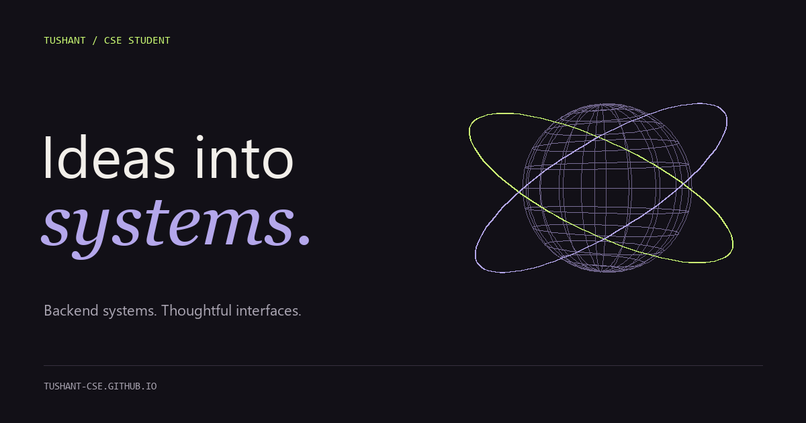
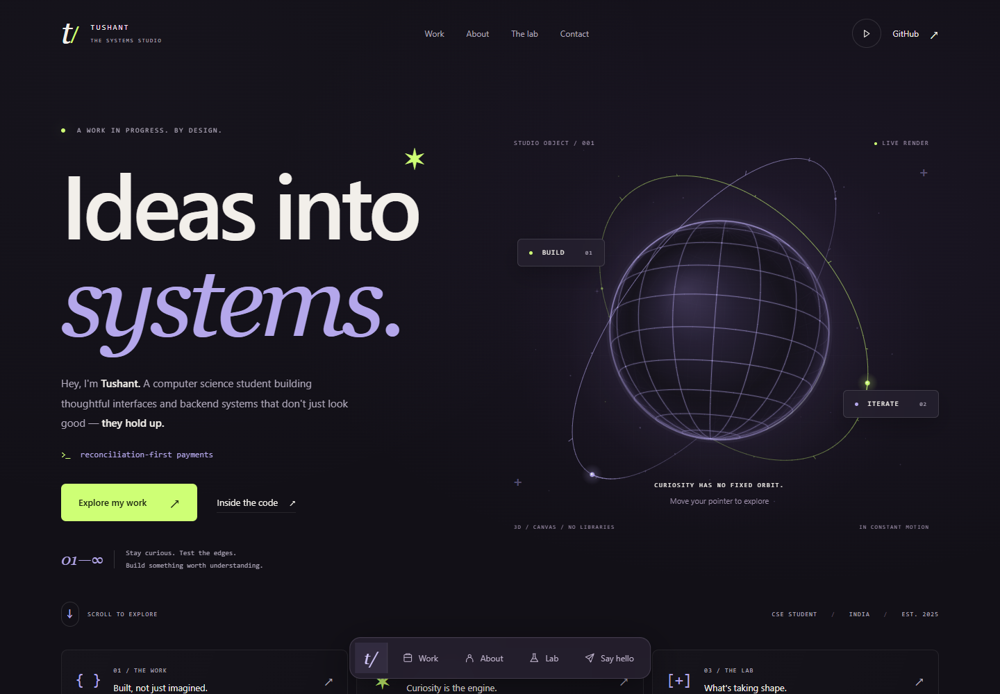
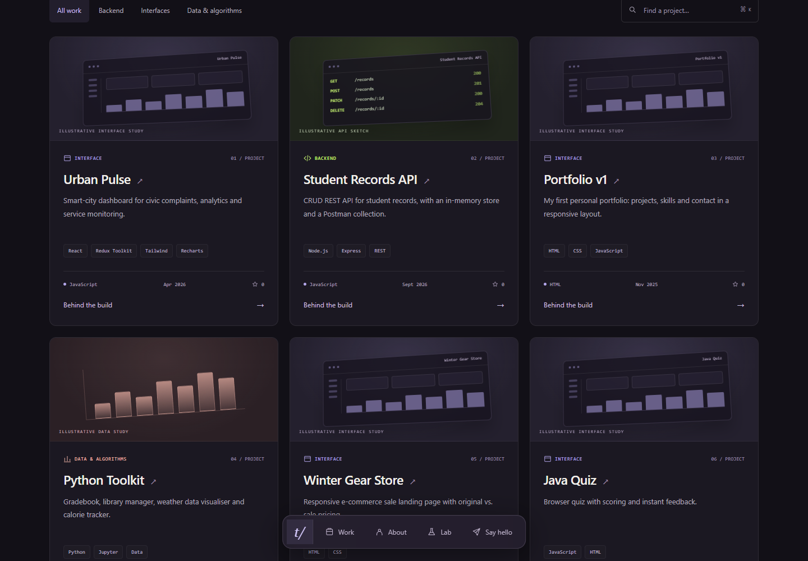
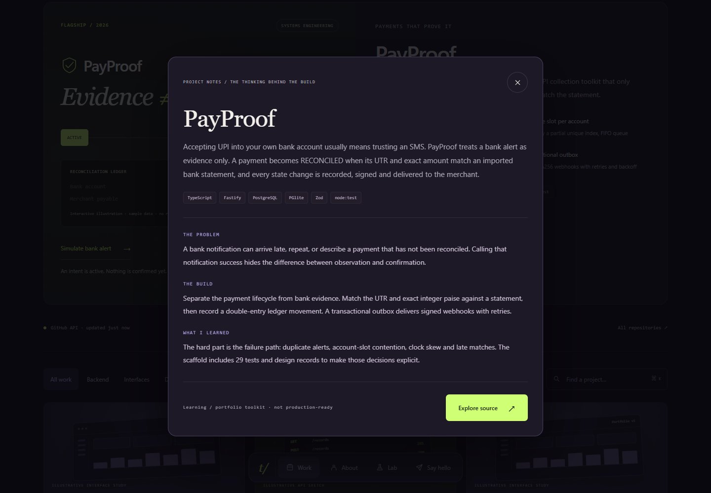
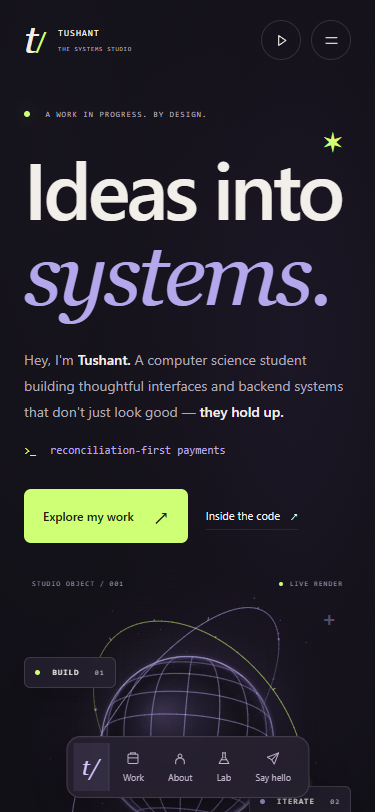
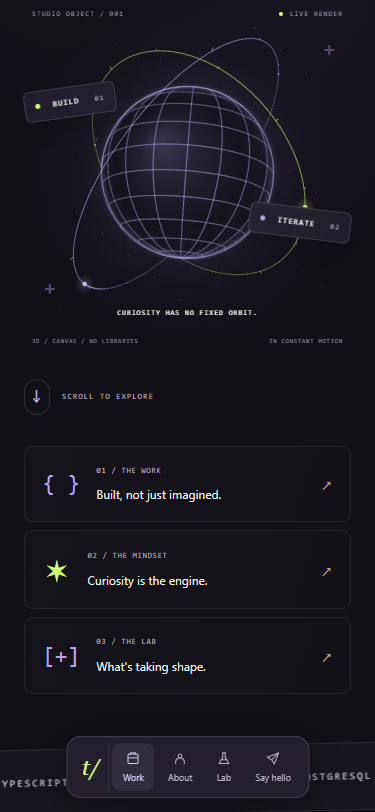

<p align="center">
  
</p>

# Tushant · The Systems Studio

An original, animated developer portfolio for a computer science student exploring thoughtful interfaces, backend engineering, and systems that are honest about their state.

A perspective-rendered orbital globe. Project stories instead of buzzwords. A live GitHub gallery with a useful offline fallback. Built with HTML, CSS, and vanilla JavaScript — no production framework or runtime CDN dependencies.

**[About the developer](https://github.com/TUSHANT-CSE)** · **[Explore PayProof](https://github.com/TUSHANT-CSE/payproof)**

## Demo gallery

### Desktop experience



### Projects and engineering stories





### Mobile experience

<p>
  
  
</p>

Screenshots show the local portfolio. Project covers are original schematic artwork, not screenshots of deployed products. The payment walkthrough uses labelled sample data and does not process real money. Repository counts and dates may change as the live GitHub feed refreshes.

## What is inside

- **An actual 3D projection.** A spherical lattice, tilted orbital rails, and satellites rendered on a 2D canvas with perspective and depth sorting. Pointer tilt uses a time-based damped spring.
- **Project context.** Searchable repository cards, category filters, expanded project lists, and dialogs explaining the problem, implementation, and learning behind selected builds.
- **A PayProof walkthrough.** Step through `ACTIVE → OBSERVED → RECONCILED` to see why a bank alert is evidence, not confirmation. It is an illustration, not a payment integration.
- **Live GitHub data.** Public repository metadata, a 15-minute cache, request timeout, manual retry, and a clearly labelled offline snapshot.
- **Navigation that stays out of the way.** A floating section dock, mobile menu, native scrolling, and `Ctrl/Cmd + K` to focus project search.
- **Motion with an off switch.** Persistent pause controls, system reduced-motion support, visibility handling, offscreen suspension, and a device-pixel-ratio cap.
- **An honest learning roadmap.** Planned lab ideas are distinct from existing repositories. No invented achievements, contact details, or production outcomes.

## Technology

| Layer | Implementation |
| --- | --- |
| Interface | Semantic HTML and responsive CSS |
| Application | Vanilla JavaScript ES modules |
| 3D illustration | Canvas2D with perspective projection |
| Repository feed | GitHub public REST API |
| Development server and build | Native Node.js |
| Logic and server tests | `node:test` |
| Browser tests | Playwright with Microsoft Edge |
| Production dependencies | None |

## Run locally

Requires Node.js 22 or newer. Microsoft Edge is used by the browser test configuration.

```sh
npm install
npm run dev
```

Open `http://127.0.0.1:4173/`.

On Windows, **double-click `Open Portfolio.cmd`** to start the preview and open it in your browser. The supplied launcher expects Node.js at `C:\Program Files\nodejs\node.exe`.

The website itself is static: visitors do not need Node.js or npm.

## Verification

```sh
npm test
npm run test:browser
npm run build
```

The local verification suite contains **21 logic/server tests and 14 browser tests**. It checks API validation, cache failures, safe links, search and filters, mobile navigation, overflow from 320px to 1920px, project dialogs, the illustrative payment lifecycle, and animation pausing/resuming.

Browser tests use deterministic GitHub fixtures; the application uses the real public API. The live feed was checked separately during development. Test counts describe the current suite, not a hosted CI result.

The GitHub Actions workflow runs the same checks on Windows and installs the Edge browser for Playwright.

## Publish with GitHub Pages

This repository is designed for `TUSHANT-CSE.github.io`.

After the source is uploaded:

1. Open **Settings → Pages** in this repository.
2. Under **Build and deployment**, select **Deploy from a branch**.
3. Select **main** and **/ (root)**, then click **Save**.
4. Wait for GitHub's Pages deployment to finish.

The intended public address is `https://tushant-cse.github.io/`. That address becomes a live demo only after Pages is enabled and deployment succeeds.

For another static host, `npm run build` produces the site in `dist/`.

## Personalise it

- `js/data.js` — profile, project curation, skills, timeline, and planned lab ideas.
- `css/style.css` — visual system, layout, responsive rules, and motion.
- `js/scene.js` — orbital rendering and its lifecycle.
- `index.html` — structure, metadata, and the featured project presentation.

Email and LinkedIn are intentionally unconfigured. Only GitHub is shown publicly. Optional contacts are validated before they are rendered.

## Engineering notes

The site keeps native scrolling rather than hijacking the scroll loop. The illustration uses one animation frame loop and stops when hidden, paused, offscreen, or reduced motion is requested. Decorative CSS motion also pauses offscreen where applicable.

GitHub links are constructed for the expected account rather than trusting arbitrary URLs in API responses. Text is escaped before insertion into HTML. The preview server only exposes site assets and rejects traversal and non-asset requests.

PayProof is a learning/portfolio toolkit, not a production payment processor. Lab entries are plans unless an associated public repository exists. This portfolio does not claim professional awards, employment history, or deployments that have not been verified.
